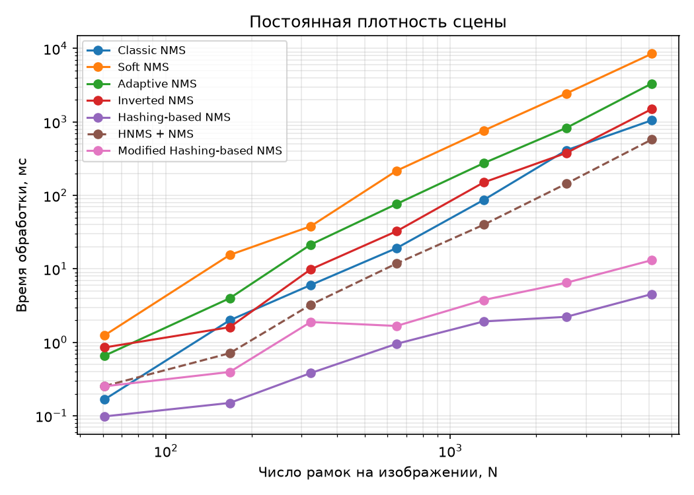
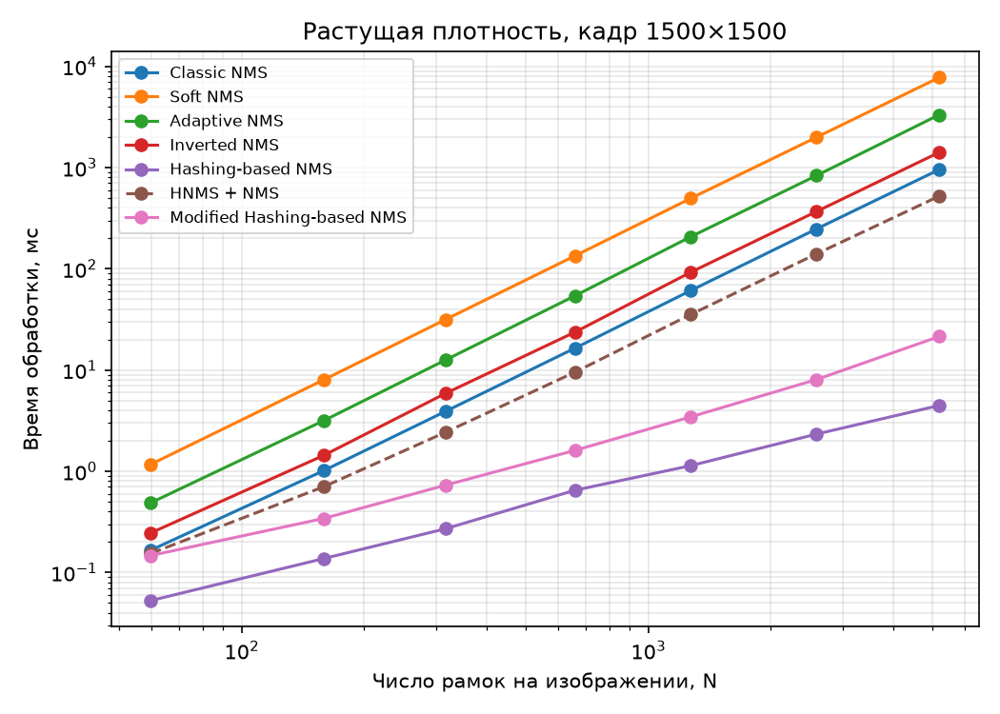
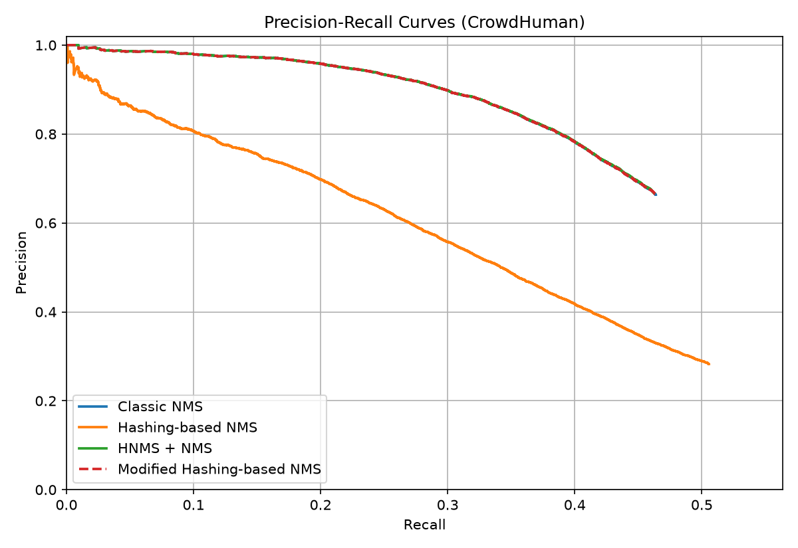
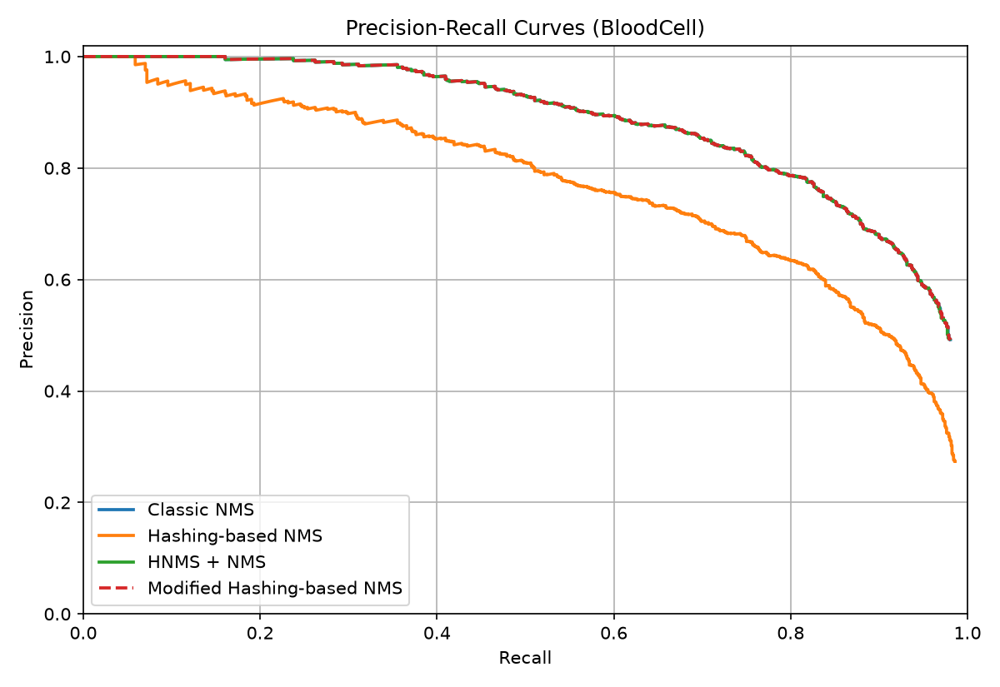

# spatial-hash-nms

**English** | [Русский](README.ru.md)

**Speeding up classic Non-Maximum Suppression with spatial hashing**


Code and results of a graduation thesis on Non-Maximum Suppression (NMS), the post-processing step
in which an object detector removes duplicate bounding boxes. The thesis implements and compares five
well-known NMS methods and proposes a modification of **Hashing-based NMS** that:

- produces **exactly the same output as classic NMS**, which is proven and verified: 0 mismatches
  on 20,316 boxes from two test sets and on 3,000 random tests;
- is **3.6× faster** than classic NMS on a synthetic set of 10,000 images
  and **80× faster** at ~5,000 boxes per image;
- scales **almost linearly** with the number of boxes when scene density is constant.

---

## Contents

- [Idea](#idea)
- [Results](#results)
- [Repository structure](#repository-structure)
- [Installation](#installation)
- [Usage](#usage)
- [Reproducing the experiments](#reproducing-the-experiments)
- [Limitations](#limitations)
- [References](#references)

## Idea

Classic (greedy) NMS sorts boxes by confidence and compares each box with the boxes already kept,
which is O(N²). Hashing-based NMS [Wang et al., 2020] avoids pairwise comparisons: boxes are hashed
into a grid, and each cell keeps only the box with the highest confidence. This is linear, but the
suppression decision is made **by hash-code collision, not by actual overlap**: two near-identical
duplicates on opposite sides of a cell boundary both survive. On CrowdHuman, precision drops
from 0.892 to 0.526.

The proposed modification uses the hash table **as a spatial index rather than as a suppression
criterion**:

1. Each box is placed into a cell of a square grid by its center. The cell size α is half the median
   box size in the image (it affects only speed, not the result).
2. Boxes are processed in descending order of confidence, as in classic NMS.
3. A candidate is compared by IoU only with the already kept boxes in the neighborhood
   `|i − u| ≤ rx, |j − v| ≤ ry`, whose radius depends on the candidate's size:

   $$r_x = \max\left(1, \left\lceil \frac{k(T)\cdot w}{\alpha} \right\rceil\right),\quad
     r_y = \max\left(1, \left\lceil \frac{k(T)\cdot h}{\alpha} \right\rceil\right),\quad
     k(T) = \max\left(1 - T, \frac{1 - T}{2T}\right)$$

4. The candidate is kept if its IoU with every box in the neighborhood is below the threshold T.

**Claim.** If IoU(b₁, b₂) ≥ T, the horizontal distance between the box centers is at most k(T)·w₁
and the vertical distance is at most k(T)·h₁ (for T ≥ 0.5 these are (1 − T)·w₁ and (1 − T)·h₁).
Hence every box that could suppress the candidate lies in its neighborhood, and the suppression
decision is identical to classic NMS. The proof is given in the thesis (section "Mathematical
formalization of the algorithm").

The complexity is **O(N log N + N·m)**, where m is the average number of kept boxes in a neighborhood.
For bounded scene density, m does not depend on N; in the worst case (all boxes in one neighborhood)
the algorithm degenerates into classic NMS.

Implementation: [`ModifiedNMS.py`](ModifiedNMS.py), about 40 lines of pure Python.

## Results

All algorithms are implemented in Python without vectorization and compared under identical
conditions (Intel Core i7-12700, IoU threshold = 0.5).

### Speed on synthetic data

10,000 images with 5 to 50 objects each and 3–10 duplicate boxes around every object
(179 boxes per image on average).

| Algorithm | Complexity | Time, s |
|---|---|---:|
| Hashing-based NMS | O(N) | 2.09 |
| **Modified Hashing-based NMS** | O(N log N + N·m) | **5.96** |
| HNMS + NMS (cascade) | O(N + N′²) | 15.67 |
| Classic NMS | O(N²) | 21.55 |
| Inverted NMS | O(N²) | 34.49 |
| Adaptive NMS | O(N²) | 78.73 |
| Soft NMS | O(N²) | 182.62 |

<table>
  <tr>
    <td></td>
    <td></td>
  </tr>
  <tr>
    <td align="center">Constant scene density: at N ≈ 5107 the modification is 80× faster than Classic NMS</td>
    <td align="center">Growing density (1500×1500 frame): 45× faster at N ≈ 5186</td>
  </tr>
</table>

### Quality on real data

The built-in NMS of the YOLOv8n detector is disabled, so the algorithms receive every box with
confidence ≥ 0.05. Precision, Recall and F1 are reported at a confidence threshold of 0.25, AP50
over the full PR curve, and time per image.

**CrowdHuman**: 929 images, 25,816 people, YOLOv8n (COCO), 155 boxes per image on average.

| Algorithm | Precision | Recall | F1 | AP50 | Time, ms |
|---|---:|---:|---:|---:|---:|
| Classic NMS | 0.892 | 0.305 | 0.454 | 0.420 | 0.94 |
| Soft NMS | 0.903 | 0.298 | 0.448 | 0.428 | 8.49 |
| Adaptive NMS | 0.849 | 0.310 | 0.454 | 0.417 | 2.45 |
| Inverted NMS | 0.895 | 0.303 | 0.452 | 0.408 | 2.14 |
| Hashing-based NMS | 0.526 | 0.323 | 0.400 | 0.311 | 0.17 |
| HNMS + NMS | 0.893 | 0.304 | 0.454 | 0.419 | 0.61 |
| **Modified Hashing-based NMS** | **0.892** | **0.305** | **0.454** | **0.420** | **0.74** |

**Blood Cell**: 87 images, 1,140 cells of three classes, YOLOv8n fine-tuned on this dataset,
258 boxes per image on average.

| Algorithm | Precision | Recall | F1 | AP50 | Time, ms |
|---|---:|---:|---:|---:|---:|
| Classic NMS | 0.632 | 0.932 | 0.753 | 0.875 | 2.35 |
| Soft NMS | 0.640 | 0.927 | 0.757 | 0.873 | 14.86 |
| Adaptive NMS | 0.628 | 0.932 | 0.750 | 0.875 | 4.27 |
| Inverted NMS | 0.632 | 0.931 | 0.753 | 0.872 | 3.71 |
| Hashing-based NMS | 0.453 | 0.934 | 0.610 | 0.768 | 0.45 |
| HNMS + NMS | 0.632 | 0.932 | 0.753 | 0.875 | 1.02 |
| **Modified Hashing-based NMS** | **0.632** | **0.932** | **0.753** | **0.875** | **0.83** |

<table>
  <tr>
    <td></td>
    <td></td>
  </tr>
  <tr>
    <td align="center">CrowdHuman</td>
    <td align="center">Blood Cell</td>
  </tr>
</table>

### Box-level agreement with classic NMS

| Dataset | Compared algorithm | Boxes kept by Classic NMS | Mismatches |
|---|---|---:|---:|
| CrowdHuman | Modified Hashing-based NMS | 18,045 | **0** |
| CrowdHuman | HNMS + NMS | 18,045 | 346 |
| Blood Cell | Modified Hashing-based NMS | 2,271 | **0** |
| Blood Cell | HNMS + NMS | 2,271 | 13 |
| Random tests (3,000, T from 0.2 to 0.8, various α) | Modified Hashing-based NMS | — | **0** |

### Other findings

- **Classic, Soft, Adaptive and Inverted NMS are practically equivalent** in quality: F1 differs
  by at most 0.007, and the 95% bootstrap intervals of the difference from Classic NMS are small
  and change sign between datasets. Soft NMS stands out with a higher AP50 on CrowdHuman but is the slowest.
- **Adaptive NMS without a density prediction branch** reduces to classic NMS with a threshold of 0.7:
  the metrics match to three decimal places on both datasets.
- **Hashing-based NMS** is sensitive to α and the number of hash functions K: the best setting
  (α = 0.5, K = 4) almost matches Classic NMS in F1 (0.453) but has lower precision, and its time
  grows proportionally to K.
- **Cell size** of the modified algorithm in the range of 0.25–4 median box sizes does not change
  the result; time is minimal at half the median size, which is the default.

All tables are available as CSV files in [`results/`](results).

### Which method to use

| Situation | Recommendation |
|---|---|
| Some loss of precision is acceptable, only speed matters | Hashing-based NMS |
| Few boxes, quality close to Classic NMS is needed | HNMS + NMS |
| Exact agreement with Classic NMS is required, or there are many boxes (dense scenes, low confidence threshold, high resolution) | **Modified Hashing-based NMS** |
| AP matters, time is not critical | Soft NMS |

## Repository structure

```
.
├── NMS.py              # Classic, Soft, Adaptive, Hashing-based, HNMS + NMS, Inverted NMS
├── ModifiedNMS.py      # proposed algorithm: modified_hashing_nms
├── SPEEDBenchmark.py   # speed on synthetic data and scaling with N
├── Evaluate.py         # Precision / Recall / F1 / AP50 and PR curves on CrowdHuman and Blood Cell
├── Ablation.py         # bootstrap intervals, HNMS sensitivity, cell size, agreement checks
├── tests/              # pytest: modified_hashing_nms vs. classic_nms and basic checks
├── predictions/        # raw YOLOv8n predictions on the test sets (cache, no datasets needed)
├── weights/            # YOLOv8n fine-tuned on Blood Cell
├── results/            # CSV files and plots used in the thesis
└── data/               # place the datasets here (see data/README.md)
```

## Installation

```bash
git clone https://github.com/flantick/spatial-hash-nms.git
cd spatial-hash-nms
python -m venv .venv
source .venv/bin/activate        # Windows: .venv\Scripts\activate
pip install -r requirements.txt
```

The algorithms themselves (`NMS.py`, `ModifiedNMS.py`) use only the Python standard library.
`ultralytics` is needed only to regenerate the detector predictions.

## Usage

Every algorithm takes a list of boxes `(x1, y1, x2, y2, score)` and an IoU threshold and returns
the filtered list:

```python
from NMS import classic_nms
from ModifiedNMS import modified_hashing_nms

detections = [
    (10, 10, 110, 110, 0.95),
    (12, 14, 108, 112, 0.80),   # duplicate of the first box
    (300, 40, 380, 160, 0.70),
]

kept = modified_hashing_nms(detections, iou_threshold=0.5)
assert kept == classic_nms(detections, 0.5)
print(kept)  # [(10, 10, 110, 110, 0.95), (300, 40, 380, 160, 0.7)]
```

The `alpha` parameter sets the grid cell size; by default it is half the median box size.

## Reproducing the experiments

Run the scripts from the repository root; they write their output to `results/`.

```bash
# Speed on synthetic data (Table 1, Figures 6, 9, 10). Slow: Soft NMS at large N.
python SPEEDBenchmark.py

# Quality metrics and PR curves (Tables 2, 3, 5, 6, Figures 7, 8, 11, 12).
# Uses the cache in predictions/, no datasets needed.
python Evaluate.py                 # both datasets
python Evaluate.py CrowdHuman      # or just one

# Additional experiments: bootstrap, sensitivity, cell size, agreement checks
python Ablation.py

# Tests
pytest
```

To regenerate the detector predictions, download the datasets as described in
[`data/README.md`](data/README.md), delete the corresponding file from `predictions/` and run `Evaluate.py`.
CrowdHuman uses the pretrained `yolov8n.pt` (ultralytics downloads it automatically),
Blood Cell uses `weights/bloodcell_yolov8n.pt`.

Absolute timings depend on the CPU; quality metrics are reproduced exactly.

## Limitations

- All algorithms are implemented in pure Python. Optimized implementations (e.g. `torchvision.ops.nms`
  in C++/CUDA) are much faster, so the absolute timings do not carry over to them. The conclusion about
  asymptotic behavior still holds.
- At 150–250 boxes per image NMS takes a fraction of a millisecond, while YOLOv8n itself takes about
  6 ms on an RTX 5060 Ti, so the speed-up becomes noticeable with thousands of candidates per image.
- The low recall on CrowdHuman (about 0.30) is due to the detector: YOLOv8n is trained on COCO
  and was not fine-tuned on CrowdHuman. The same detector is used for every algorithm, so this does
  not affect the comparison.

## References

1. Wang J., Yin X., Wang L., Zhang L. [Hashing-based Non-Maximum Suppression for Crowded Object Detection](https://arxiv.org/abs/2005.11426). arXiv, 2020.
2. Bodla N., Singh B., Chellappa R., Davis L. S. Soft-NMS — Improving Object Detection with One Line of Code. ICCV, 2017.
3. Liu S., Huang D., Wang Y. [Adaptive NMS: Refining Pedestrian Detection in a Crowd](https://arxiv.org/abs/1904.03629). CVPR, 2019.
4. Liu L., Zhou L. [Inverted Non-maximum Suppression for More Accurate and Neater Face Detection](https://arxiv.org/abs/2305.10593). arXiv, 2023.
5. Shao S. et al. [CrowdHuman: A Benchmark for Detecting Human in a Crowd](https://arxiv.org/abs/1805.00123). arXiv, 2018.
6. Teschner M. et al. Optimized Spatial Hashing for Collision Detection of Deformable Objects. VMV, 2003.
7. Jocher G., Chaurasia A., Qiu J. [Ultralytics YOLOv8](https://github.com/ultralytics/ultralytics), 2023.

The full list is in the thesis.

## License

The code is released under the [MIT](LICENSE) license. The CrowdHuman and Blood Cell datasets (Roboflow)
are distributed under CC BY 4.0 and are not included in this repository.
